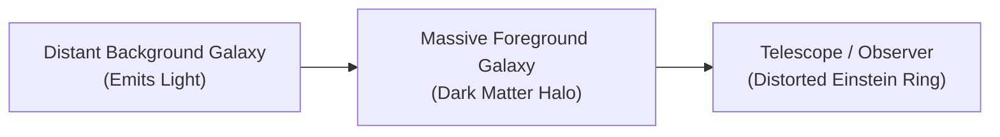
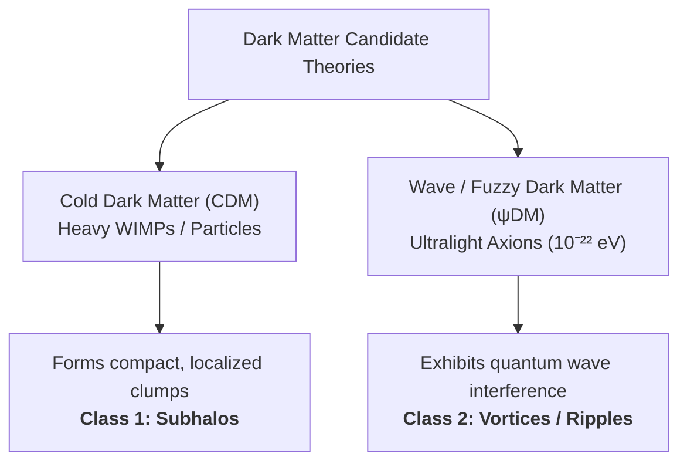
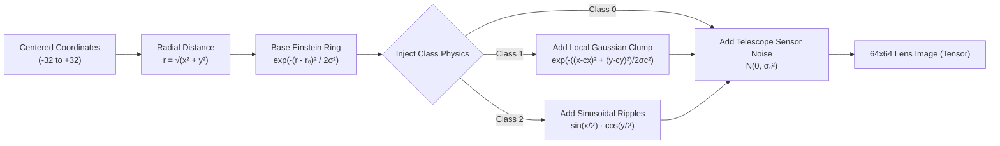
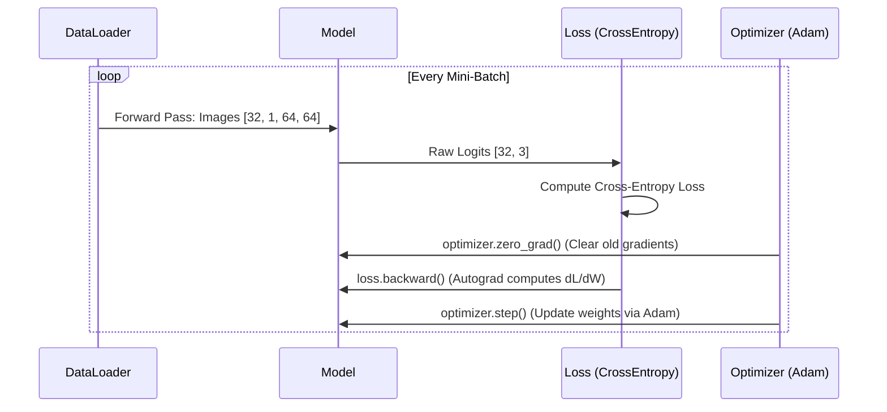

# DeepLense: Complete Conceptual & Technical Guide

This guide provides a complete, connected understanding of the **DeepLense-DeepLearning** project. It bridges astrophysical theory, mathematical modeling, PyTorch implementation details, and deep learning architectural trade-offs.

---

## 1. The Big Picture: Why Gravitational Lensing?



### The Astrophysical Problem
- **Dark Matter** constitutes $\approx 85\%$ of the total matter in the universe, but it does not emit, absorb, or reflect electromagnetic radiation (light). We cannot see it directly.
- **How do we detect it?** Through **Einstein's General Theory of Relativity**. Mass bends spacetime. When light from a distant galaxy passes near a massive foreground galaxy (a "lens"), its path is bent. This phenomenon is called **Strong Gravitational Lensing**.
- When the background source, the lens, and the observer align precisely, the distorted light forms a closed circular arc known as an **Einstein Ring**.

### The Core Scientific Question
Astrophysicists don't just want to confirm dark matter exists—they want to know **what kind of particle it is**. 
Different dark matter theories predict different microscopic behaviors that leave tiny, characteristic morphological "fingerprints" on the Einstein ring:



---

## 2. The Three Morphological Classes

| Class ID | Physics Category | Physical Nature | Visual / Morphological Signature |
| :--- | :--- | :--- | :--- |
| **0: No-Sub** | Smooth Macro-Lens | A perfectly smooth gravitational potential without local clumps. | A symmetric, uniform circular Gaussian ring + sensor noise. |
| **1: Subhalo** | Cold Dark Matter (CDM) | Massive, collisionless particles clump into small, compact satellite halos orbiting the main galaxy. | A **localized bright clump or arc distortion** at a specific point along the ring. |
| **2: Vortex** | Wave / Axion ($\psi$DM) | Ultralight bosons have astronomical de Broglie wavelengths ($\sim \text{kpc}$), behaving as a quantum wave. | **Periodic sinusoidal ripples and interference fringes** distributed globally across the ring. |

---

## 3. Mathematical Simulation: From Physics to Pixels

In `generate_synthetic_lenses()` in `benchmark.py`, we simulate 64x64 single-channel telescope observations:



### The Equations:
1. **Centered Radial Grid:**
   $$\Delta x, \Delta y \in [-32, 32], \quad r = \sqrt{x^2 + y^2}$$
2. **Base Einstein Ring:**
   $$I_{\text{base}}(r) = \exp\left(-\frac{(r - r_0)^2}{2\sigma_r^2}\right) \quad (r_0 = 18\text{ px}, \sigma_r = 3.5\text{ px})$$
3. **Subhalo Perturbation (Class 1):**
   $$I_{\text{sub}}(x, y) = 0.8 \cdot \exp\left(-\frac{(x - c_x)^2 + (y - c_y)^2}{2\sigma_c^2}\right) \quad (c_x, c_y \in [-15, 15] \text{ random centroid})$$
4. **Vortex Ripple Perturbation (Class 2):**
   $$I_{\text{vortex}}(x, y) = 0.3 \cdot \sin\left(\frac{x}{2.0}\right) \cos\left(\frac{y}{2.0}\right)$$
5. **Sensor Noise:**
   $$I_{\text{final}} = I + \mathcal{N}(0, 0.08^2)$$

---

## 4. PyTorch Data Pipeline

```python
class LensDataset(Dataset):
    def __init__(self, images, labels):
        self.images = torch.tensor(images, dtype=torch.float32)
        self.labels = torch.tensor(labels, dtype=torch.long)
    def __len__(self): return len(self.images)
    def __getitem__(self, idx): return self.images[idx], self.labels[idx]
```

### Key PyTorch Concepts:
- **Tensor Shape `(B, C, H, W)`:** PyTorch image models expect batches arranged as **Batch Size ($B$)**, **Channels ($C$)**, **Height ($H$)**, **Width ($W$)**. For our single-channel 64x64 images, a batch is `[32, 1, 64, 64]`.
- **Labels as LongTensor:** Classification targets are integer indices ($0, 1, 2$) required by `nn.CrossEntropyLoss`.
- **DataLoader Roles:** 
  - `shuffle=True` on the training set breaks temporal correlation between consecutive batches.
  - `shuffle=False` on the validation set ensures deterministic, reproducible metric evaluation.

---

## 5. Model Architectures: CNN vs. Hybrid Transformer

```mermaid
flowchart TD
    subgraph ResNet["ResNet-18 (Classical CNN Baseline)"]
        R1["Input: 1 x 64 x 64"] --> R2["Conv1: 7x7 stride 2 (64 channels)"]
        R2 --> R3["4 Residual Stages (BasicBlocks)"]
        R3 --> R4["Global Average Pooling"]
        R4 --> R5["FC Head: 512 -> 3 logits"]
    end

    subgraph CoAtNet["CoAtNet-Nano (Hybrid CNN-Transformer)"]
        C1["Input: 1 x 64 x 64"] --> C2["Stage 1 & 2: MBConv (Depthwise Convolutions)"]
        C2 --> C3["Stage 3 & 4: Relative Self-Attention Blocks"]
        C3 --> C4["Global Average Pooling"]
        C4 --> C5["Linear Head: 3 logits"]
    end
```



### 1. ResNet-18 (CNN Baseline)
- **Why adapt `conv1`?** Pre-trained torchvision ResNet models expect 3-channel RGB (`in_channels=3`). Astronomical images from telescope detectors are single-channel grayscale (`in_channels=1`). We modify:
  ```python
  model.conv1 = nn.Conv2d(1, 64, kernel_size=7, stride=2, padding=3, bias=False)
  ```
- **Residual Connections:** $y = \mathcal{F}(x) + x$. By adding the input identity to the residual mapping, gradients flow unimpeded through the skip connection during backpropagation, eliminating the vanishing gradient problem.
- **Inductive Bias:** Convolutions assume **locality** (nearby pixels are related) and **translation equivariance** (a feature is recognized regardless of where it appears in the frame).

### 2. CoAtNet-Nano (Hybrid Transformer via `timm`)
- **The Transformer Challenge in Vision:** Standard Vision Transformers (ViTs) divide images into patches and apply self-attention ($Q, K, V$). While attention captures long-range dependencies, it has **zero spatial inductive bias**—it must learn from scratch that adjacent pixels belong together, requiring huge datasets.
- **The CoAtNet Solution:** Marries **Convolution** + **Attention**:
  - **Early Stages (1 & 2):** Use convolutional blocks (`MBConv` with depthwise separable filters) to extract fine-grained, localized spatial edges.
  - **Late Stages (3 & 4):** Use relative multi-head self-attention to correlate features across the entire image field.
- **Native Resolution (`img_size=64`):** Passing `img_size=64` to `timm.create_model()` adjusts the internal patch/token grids natively, cutting CPU compute time from 17s down to 1.6s per step without needing interpolation.

---

## 6. Training & Optimization Mechanics



### Key Technical Terms:
1. **Logits vs. Probabilities:** The model outputs raw unconstrained scores (logits $z_i$). Softmax converts them into normalized class probabilities:
   $$P(y = i) = \frac{e^{z_i}}{\sum_{j=0}^{2} e^{z_j}}$$
2. **Cross-Entropy Loss:** Penalizes the model based on the log probability assigned to the true class:
   $$\mathcal{L} = -\log P(y_{\text{true}})$$
3. **Adam Optimizer:** Computes adaptive learning rates for each parameter by maintaining exponentially decaying averages of past gradients (momentum) and squared gradients (variance).

---

## 7. Scientific Evaluation Metrics

### 1. Confusion Matrix
A $3 \times 3$ grid comparing true labels vs. predicted labels. Diagonal elements are correct predictions; off-diagonal elements identify specific failure modes (e.g., misclassifying a Subhalo as No-Sub).

### 2. Multi-Class One-vs-Rest (OvR) ROC & AUROC
- **ROC (Receiver Operating Characteristic) Curve:** Plots **True Positive Rate** (Sensitivity) against **False Positive Rate** ($1 - \text{Specificity}$) as the decision threshold varies from $0.0$ to $1.0$.
- **AUROC (Area Under the ROC Curve):** Measures discrimination capability independent of any chosen classification threshold:
  - $\text{AUROC} = 1.0$: Perfect discrimination.
  - $\text{AUROC} = 0.5$: Random guessing (diagonal baseline).
- **Macro AUROC:** The unweighted arithmetic mean of the three individual class AUROCs:
  $$\text{Macro AUROC} = \frac{\text{AUC}_{\text{no\_sub}} + \text{AUC}_{\text{subhalo}} + \text{AUC}_{\text{vortex}}}{3}$$

---

## 8. Analyzing Our Empirical Benchmark Results

```text
| Model Backbone | Architecture Class | Parameters | Macro AUROC | No-Sub | Subhalo (CDM) | Vortex (Axion) |
| :---           | :---               | :---:      | :---:       | :---:  | :---:         | :---:          |
| ResNet-18      | CNN Baseline       | ~11.2M     | 1.0000      | 1.0000 | 1.0000        | 1.0000         |
| CoAtNet-Nano   | Hybrid Transformer | ~14.6M     | 0.7688      | 0.7868 | 0.5197        | 1.0000         |
```

### Why Did This Happen? (The Physical & Architectural Connection)

1. **Why CoAtNet achieved 1.0000 on Vortex (Axion):**
   - The Vortex class features sinusoidal ripples spread across the entire 64x64 frame.
   - Self-attention computes all-to-all pixel correlations, making it naturally suited to capture distributed, periodic frequency patterns.
2. **Why CoAtNet struggled with Subhalos (CDM) from scratch (0.5197):**
   - A subhalo is a tiny, localized clump occupying only 4–8 pixels.
   - Without pre-training on millions of images, self-attention distributes attention weights broadly across the image rather than focusing sharply on a local spatial perturbation.
3. **Why ResNet-18 reached 1.0000 on everything:**
   - Small $3 \times 3$ convolutional kernels hard-code locality. The sliding window naturally isolates local brightness anomalies (subhalos) without needing to learn spatial adjacency from data.

---

## 9. Summary 

```text
Problem: Classify dark matter substructure from strong lensing Einstein rings.
Data:    Single-channel 64x64 images (No-Sub, Subhalo CDM, Vortex Axion).
Models:  ResNet-18 (pure CNN) vs. CoAtNet-Nano (Hybrid CNN + Self-Attention).
Verdict: Pure CNNs excel at localized point-mass detection in low-data regimes;
         Transformers excel at capturing distributed wave-like interference.
```
