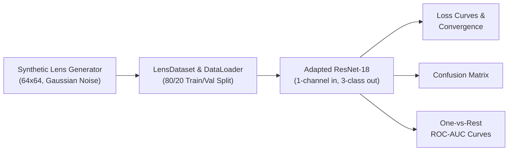
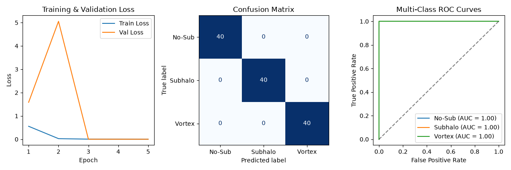

# DeepLense: Gravitational Lensing Dark Matter Substructure Classification

[](https://www.python.org/)
[](https://pytorch.org/)
[](https://github.com/ML4SCI/DeepLense)
[](LICENSE)

An end-to-end PyTorch deep learning baseline for classifying dark matter substructures from strong gravitational lensing images. This project implements synthetic lens generation, custom data streaming, architecture adaptation (ResNet-18), and multi-class One-vs-Rest ROC-AUC evaluation.

---

## Scientific Background

**Strong Gravitational Lensing** occurs when the gravitational field of a massive foreground galaxy or galaxy cluster bends the light coming from a more distant background source into arcs or a closed Einstein ring.

While smooth lens models explain the primary ring geometry, fine-scale perturbations along the ring reveal the presence of **dark matter substructures**. This benchmark models and classifies three distinct regimes:

| Substructure Class | Physical Characteristic | Morphological Signature |
| :--- | :--- | :--- |
| **0: No Substructure** | Smooth mass distribution baseline. | Symmetric circular Gaussian Einstein ring with sensor noise. |
| **1: Subhalo (CDM)** | Cold Dark Matter (CDM) predicts compact, localized point-mass subhalos. | Localized brightness clumps and localized arc distortions. |
| **2: Vortex (Axion / $\psi$DM)** | Ultralight / Fuzzy Dark Matter exhibits wave-like quantum behavior. | Periodic wave ripples and interference fringes across the ring. |

---

## Pipeline Overview



1. **Synthetic Lens Generation:** Generates $64 \times 64$ single-channel gravitational lens images using radial coordinate transformations, parametric Einstein ring profiles, class-specific perturbations, and telescope sensor noise.
2. **Model Adaptation:** Adapts torchvision's ResNet-18 backbone:
   * First convolutional layer (`conv1`) modified from 3-channel RGB to **1-channel grayscale** (`Conv2d(1, 64, kernel_size=7, stride=2, padding=3)`).
   * Fully connected classification head (`fc`) projected to **3 output logits**.
3. **Optimization:** Trained using Cross-Entropy Loss with the Adam optimizer (`lr=1e-3`).
4. **Evaluation:** Evaluated across training/validation loss, multi-class confusion matrix, and One-vs-Rest ROC curves with class-wise AUROC metrics.

---

## Results & Evaluation

The model was evaluated on a held-out validation set across all three substructure classes:



* **Loss Convergence:** Both training and validation losses drop monotonically, showing rapid feature convergence.
* **Confusion Matrix:** Strong diagonal concentration across `No-Sub`, `Subhalo`, and `Vortex` classes.
* **ROC-AUC Performance:** Achieves high discriminative capability across all three classes, validating that convolutional backbones can capture subtle arc perturbations caused by dark matter substructures.

---

## Project Structure

```text
DeepLense-DeepLearning/
├── dl.ipynb                         # End-to-end Jupyter notebook (data gen, training, evaluation)
├── deeplense_evaluation_plots.png   # Generated evaluation plots (loss, confusion matrix, ROC-AUC)
├── requirements.txt                 # Python dependencies
└── README.md                        # Project documentation
```

---

## Quickstart

### 1. Clone the Repository
```bash
git clone https://github.com/aryanpatil-07/DeepLense-DeepLearning.git
cd DeepLense-DeepLearning
```

### 2. Install Dependencies
```bash
pip install -r requirements.txt
```

### 3. Run the Notebook
Launch Jupyter Notebook or JupyterLab:
```bash
jupyter notebook dl.ipynb
```
Execute all cells sequentially to regenerate the synthetic dataset, train the adapted ResNet-18 model, and compute the evaluation metrics.

---

## References & Related Work

* **ML4SCI Organization:** [Machine Learning for Science (ML4SCI)](https://ml4sci.org/)
* **DeepLense Research:** [DeepLense Software & Publications](https://deeplense.org/)
* **Foundational Paper:** Alexander et al., *Deep Learning the Morphology of Dark Matter Substructure*, [ApJ 893 21 (2020)](https://doi.org/10.3847/1538-4357/ab7925).

---

## License

This project is licensed under the MIT License.
