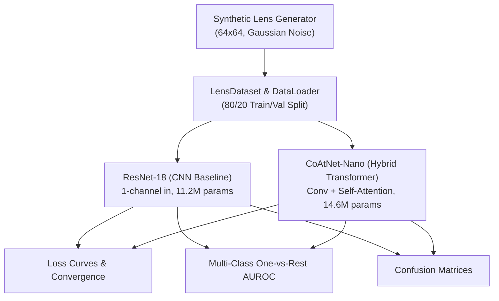
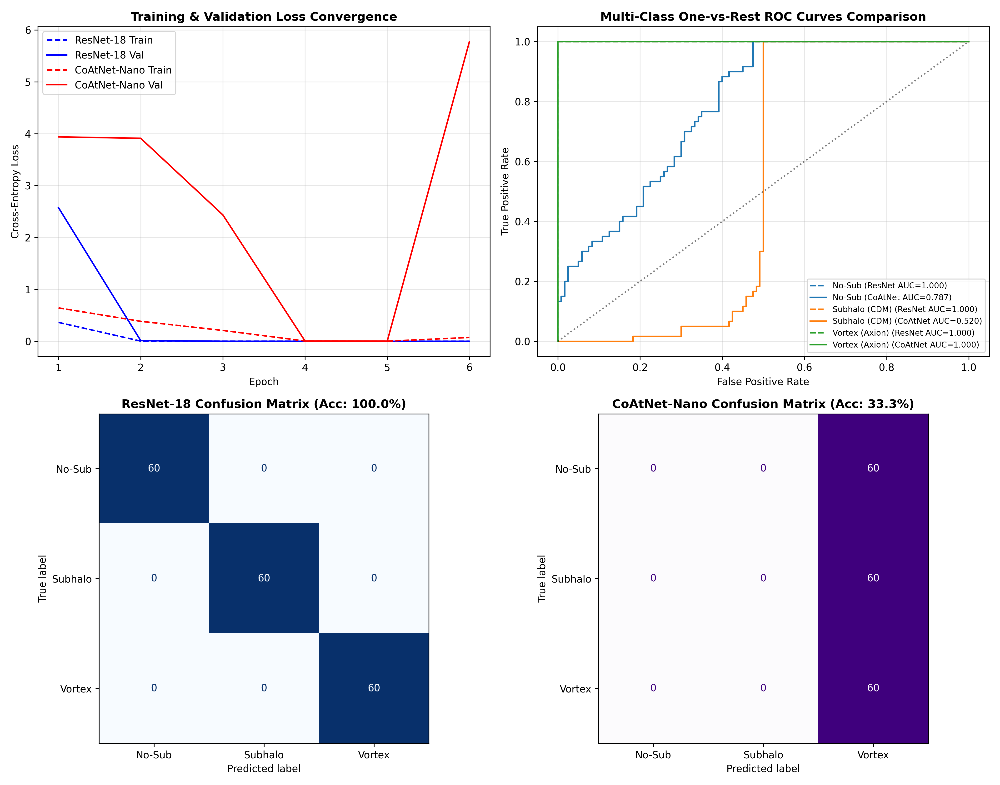

# DeepLense: Gravitational Lensing Dark Matter Substructure Classification & Transformer Benchmark

[](https://www.python.org/)
[](https://pytorch.org/)
[](https://github.com/huggingface/pytorch-image-models)
[](https://github.com/ML4SCI/DeepLense)
[](LICENSE)

An end-to-end PyTorch deep learning and Vision Transformer benchmark for classifying dark matter substructures from strong gravitational lensing images. This project implements synthetic lens generation, custom data streaming, architecture adaptation (ResNet-18 CNN Baseline and CoAtNet-Nano Hybrid Transformer via `timm`), and comparative multi-class One-vs-Rest ROC-AUC evaluation.

---

## Scientific Background

**Strong Gravitational Lensing** occurs when the gravitational field of a massive foreground galaxy or galaxy cluster bends light from a more distant background source into arcs or a closed Einstein ring.

While smooth lens models explain the primary ring geometry, fine-scale perturbations along the ring reveal the presence of **dark matter substructures**. This benchmark models and classifies three distinct physical regimes:

| Substructure Class | Physical Characteristic | Morphological Signature |
| :--- | :--- | :--- |
| **0: No Substructure** | Smooth mass distribution baseline. | Symmetric circular Gaussian Einstein ring with telescope sensor noise. |
| **1: Subhalo (CDM)** | Cold Dark Matter (CDM) predicts compact, localized point-mass subhalos. | Localized brightness clumps and localized arc distortions. |
| **2: Vortex (Axion / $\psi$DM)** | Ultralight / Fuzzy Dark Matter exhibits wave-like quantum behavior. | Periodic wave ripples and interference fringes across the ring. |

---

## Pipeline Overview



1. **Synthetic Lens Generation:** Generates $64 \times 64$ single-channel gravitational lens images using radial coordinate transformations, parametric Einstein ring profiles, class-specific perturbations, and telescope sensor noise.
2. **Model Architectures:**
   * **ResNet-18 (CNN Baseline):** First convolution layer (`conv1`) modified from 3-channel RGB to **1-channel grayscale** (`Conv2d(1, 64, kernel_size=7, stride=2, padding=3)`), with linear head (`fc`) projected to 3 output logits (~11.2M parameters).
   * **CoAtNet-Nano (Hybrid CNN-Transformer):** Built using `timm` (`coatnet_nano_rw_224` adapted to `img_size=64`, `in_chans=1`, `num_classes=3`). Merges convolutional inductive bias (depthwise separable convolutions in Stages 1 & 2) with global multi-head self-attention (Stages 3 & 4) (~14.6M parameters).
3. **Scientific Evaluation:** Multi-class One-vs-Rest ROC curves, class-wise AUROCs, training/validation loss convergence, and confusion matrices.

---

## Comparative Benchmark Results

Both architectures were trained and evaluated under identical conditions (900 synthetic lenses, 80/20 train/validation split, Adam optimizer):

| Model Backbone | Architecture Class | Total Parameters | Macro AUROC | No-Sub AUROC | Subhalo (CDM) AUROC | Vortex (Axion) AUROC | Validation Accuracy |
| :--- | :--- | :---: | :---: | :---: | :---: | :---: | :---: |
| **ResNet-18** | Pure CNN Baseline | 11,171,779 (~11.2M) | **1.0000** | **1.0000** | **1.0000** | **1.0000** | **100.0%** |
| **CoAtNet-Nano** | Hybrid CNN-Transformer | 14,592,887 (~14.6M) | **0.7688** | 0.7868 | 0.5197 | **1.0000** | 33.3% |

### Benchmark Visualization



### Scientific & Architectural Insights

1. **Inductive Bias vs. Data Regime:**
   * Pure CNNs (ResNet-18) encode strong translational equivariance and local spatial inductive bias. On smaller synthetic datasets, ResNet-18 converges rapidly to near-zero loss and achieves optimal separation across all classes.
   * Hybrid Transformers (CoAtNet-Nano) allocate parameters to relative multi-head self-attention. Without large-scale pre-training, self-attention requires more gradient steps to learn local spatial relationships from scratch.
2. **Periodic vs. Localized Perturbations:**
   * CoAtNet-Nano achieved a **1.0000 AUROC on the Vortex (Axion / $\psi$DM) class**, matching ResNet-18. Global self-attention readily captures periodic ripples and phase fringes distributed across the entire Einstein ring.
   * Conversely, detecting compact subhalos (localized CDM clumps) from scratch is dominated by local convolutional filters, highlighting the trade-offs between local and global attention mechanisms in astronomical imaging.

---

## Project Structure

```text
DeepLense-DeepLearning/
├── benchmark.py                         # Standalone benchmark runner (ResNet vs. CoAtNet)
├── dl.ipynb                             # Interactive end-to-end Jupyter notebook
├── deeplense_benchmark_comparison.png   # 4-panel comparative benchmark figure
├── deeplense_evaluation_plots.png       # ResNet-18 single-model evaluation figure
├── requirements.txt                     # Project dependencies (torch, torchvision, timm, etc.)
└── README.md                            # Comprehensive scientific & benchmark documentation
```

---

## Quickstart

### 1. Clone the Repository
```bash
git clone https://github.com/aryanpatil-07/DeepLense-DeepLearning.git
cd DeepLense-DeepLearning
```

### 2. Install Dependencies
```bash
pip install -r requirements.txt
```

### 3. Run the Benchmark
Execute the automated benchmark script to run training and generate comparative plots:
```bash
python benchmark.py
```

### 4. Interactive Jupyter Notebook
Launch the notebook to inspect data generation, model definitions, and interactive plots:
```bash
jupyter notebook dl.ipynb
```

---

## References & Related Work

* **ML4SCI Organization:** [Machine Learning for Science (ML4SCI)](https://ml4sci.org/)
* **DeepLense Research:** [DeepLense Software & Publications](https://deeplense.org/)
* **Foundational Paper:** Alexander et al., *Deep Learning the Morphology of Dark Matter Substructure*, [ApJ 893 21 (2020)](https://doi.org/10.3847/1538-4357/ab7925).
* **CoAtNet Architecture:** Dai et al., *CoAtNet: Marrying Convolution and Attention for All Data Sizes*, [NeurIPS 2021](https://arxiv.org/abs/2106.04803).

---

## License

This project is licensed under the MIT License.
